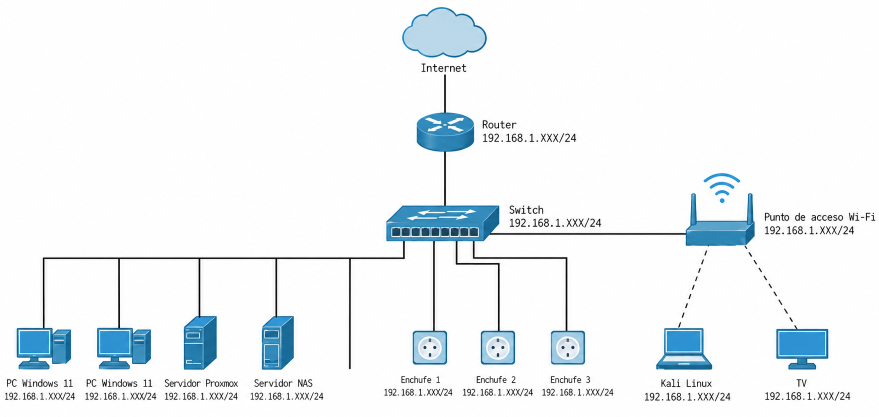
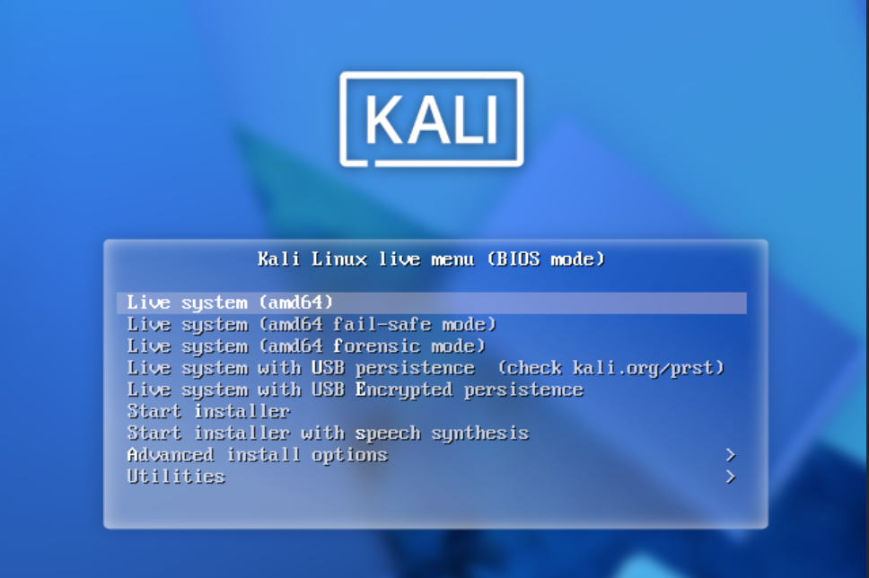
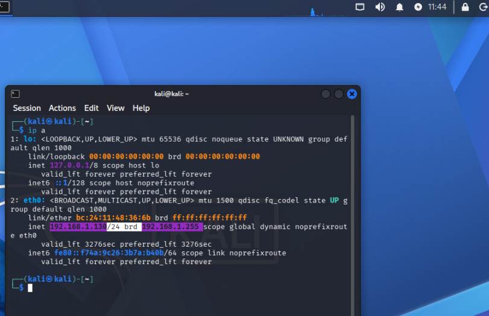
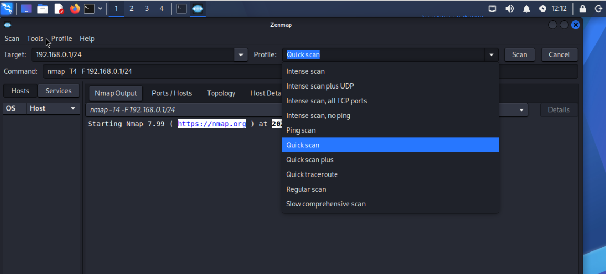

# Auditoría de redes con NMAP en KaliLinux 🛡️🛜🌐

## Índice

- [Auditoría de redes con NMAP en KaliLinux 🛡️🛜🌐](#auditoría-de-redes-con-nmap-en-kalilinux-️)
  - [Índice](#índice)
  - [Introducción](#introducción)
  - [Escenario Utilizado](#escenario-utilizado)
    - [Diagrama de red](#diagrama-de-red)
  - [Pasos principales de la auditoría con NMAP](#pasos-principales-de-la-auditoría-con-nmap)
  - [Kali Linux](#kali-linux)
  - [Comprobando la red de Kali](#comprobando-la-red-de-kali)
    - [Comprobación de IP](#comprobación-de-ip)
    - [Comprobación puerta de enlace y tabla de rutas](#comprobación-puerta-de-enlace-y-tabla-de-rutas)
  - [Tabla de comandos más utilizados](#tabla-de-comandos-más-utilizados)
  - [Nmap desde terminal Kali](#nmap-desde-terminal-kali)
  - [Zenmap (nmap interfaz gŕafica)](#zenmap-nmap-interfaz-gŕafica)
    - [Notas de Zenmap](#notas-de-zenmap)
  - [Conclusiones](#conclusiones)
  - [Referencias y documentación oficial](#referencias-y-documentación-oficial)
  - [Información del proyecto](#información-del-proyecto)

## Introducción

Aprovechando lo aprendido en años anteriores en módulos cursados de ASIR, rescato esta parte de Seguridad y Alta disponibilidad para la creación de este manual.
Explicaré cómo realizar una auditoría básica de una red local utilizando Nmap, una herramienta de código abierto que permite descubrir equipos, analizar puertos y obtener información sobre los servicios que se encuentran activos.

La auditoría se realizará desde un equipo con Kali Linux conectado a la red local. Se utilizarán tanto los comandos de Nmap desde la terminal como Zenmap, su interfaz gráfica, para conocer las posibilidades que ofrecen ambas formas de trabajo.

> La seguridad es un proceso, no un producto.
>
> -- Bruce Schneier

## Escenario Utilizado

Para realizar la práctica se utilizará una red local básica y común con direccionamiento IPv4 privado, perteneciente al rango 192.168.1.0/24.

La red dispone de varios tipos de dispositivos: equipos informáticos de usuario, servidores, dispositivos multimedia y elementos de domótica. Esta variedad permite observar cómo Nmap identifica equipos que ofrecen servicios diferentes.

### Diagrama de red



---

## Pasos principales de la auditoría con NMAP

1. Comprobando la conectividad y la dirección IP de Kali.
2. Identificando el rango de direcciones de la red.
3. Descubriendo qué dispositivos están activos.
4. Seleccionando un dispositivo para analizarlo.
5. Examinando los puertos abiertos.
6. Identificando los servicios y sus versiones.
7. Interpreción de los resultados obtenidos.

## Kali Linux

Se trata de una distribución GNU/Linux basada en Debian que incorpora numerosas herramientas orientadas a la seguridad informática, las pruebas de penetración (pentesting) y la auditoría de sistemas y redes.
Una de las ventajas de utilizar Kali Linux es que permite disponer de herramientas especializadas en un mismo entorno de trabajo. Entre ellas se encuentra Nmap, que se utilizará en esta práctica para identificar equipos y analizar los servicios expuestos en la red local.

## Comprobando la red de Kali

Lo primero es ver que la ISO de Kali arranca correctamente y tenemos una IP dentro del rango de la red local *192.168.1.0/24*



---

### Comprobación de IP

```bash
┌──(kali㉿kali)-[~]
└─$ ip a
1: lo: <LOOPBACK,UP,LOWER_UP> mtu 65536 qdisc noqueue state UNKNOWN group default qlen 1000
    link/loopback 00:00:00:00:00:00 brd 00:00:00:00:00:00
    inet 127.0.0.1/8 scope host lo
       valid_lft forever preferred_lft forever
    inet6 ::1/128 scope host noprefixroute 
       valid_lft forever preferred_lft forever
2: eth0: <BROADCAST,MULTICAST,UP,LOWER_UP> mtu 1500 qdisc fq_codel state UP group default qlen 1000
    link/ether bc:24:11:48:36:6b brd ff:ff:ff:ff:ff:ff
    inet 192.168.1.130/24 brd 192.168.1.255 scope global dynamic noprefixroute eth0
       valid_lft 3098sec preferred_lft 3098sec
    inet6 fe80::f74a:9c26:3b7a:b40b/64 scope link noprefixroute 
       valid_lft forever preferred_lft forever
                                                                                
┌──(kali㉿kali)-[~]
└─$ 
```

### Comprobación puerta de enlace y tabla de rutas

Además de conocer nuestra dirección IP, es importante identificar la puerta de enlace (default gateway). Normalmente corresponde al router que permite la comunicación con otras redes. Para consultar la tabla de rutas utilizaremos el comando `ip route`

__Salida línea de comandos:__

```bash
┌──(kali㉿kali)-[~]
└─$ ip route
default via 192.168.1.1 dev eth0 proto dhcp metric 100
192.168.1.0/24 dev eth0 proto kernel scope link src 192.168.1.130
┌──(kali㉿kali)-[~]
└─$
```

__En esta salida podemos identificar:__

- `default via 192.168.1.1` Indica que la puerta de enlace predeterminada es el router con dirección IP 192.168.1.1.

- `dev eth0` Identifica la interfaz de red utilizada.

- `192.168.1.0/24` Representa la red local a la que está conectada Kali.

- `src 192.168.1.130` Indica la dirección IP de origen utilizada por nuestra máquina.

En este punto estamos en condiciones de tener un mayor conocimiento de la configuración de red del equipo antes de comenzar el escaneo con Nmap.

---



---

Estamos en condiciones de comenzar la auditoría, pues tenemos la IP 192.168.1.130 asignada por DHCP. Esto ya nos indica que la seguridad de la red no parece tener autenticación física por MAC, como por ejemplo con una contro de acceso a la red o NAC. Podemos conectar un cable ethernet y tener acceso.

## Tabla de comandos más utilizados

|Propósito                      |Comando                                    |Descripción                                                                 |
|-------------------------------|-------------------------------------------|----------------------------------------------------------------------------|
| Descubrir hosts activos       | `nmap -sn 192.168.1.0/24`                 | Escaneo de red sin escanear puertos.                                       |
| Escanear puertos comunes      | `nmap 192.168.1.100`                      | Escaneo básico de los puertos más usados.                                  |
| Escanear TODOS los puertos    | `nmap -p- 192.168.1.100`                  | Escanea todos los puertos (1-65535).                                       |
| Versiones de servicios        | `nmap -sV -sC -p- 192.168.1.100`          | Detecta versiones de servicios y ejecuta scripts básicos.                  |
| Buscar vulnerabilidades       | `nmap --script=vuln 192.168.1.100`        | Usa scripts NSE para detectar vulnerabilidades conocidas.                  |
| Detectar el sistema operativo | `nmap -O 192.168.1.100`                   | Intenta identificar el sistema operativo del objetivo.                     |
| Escaneo TCP (conex. completa) | `nmap -sT 192.168.1.100`                  | Más ruidoso y detectable que `-sS`, pero funciona sin privilegios de root. |
| Escaneo TCP+Detección de S.O. | `nmap -sT -O 192.168.1.100`               | Escaneo con conexión completa y detección de sistema operativo.            |

## Nmap desde terminal Kali

Oculto ciertos datos, como la __MAC o nombre DNS__ por seguridad.

```bash
─$ nmap -sn 192.168.1.0/24
Starting Nmap 7.99 ( https://nmap.org ) at 2026-10-11 12:05 +0000
Nmap scan report for ********* (192.168.1.1)
Host is up (0.0012s latency).
MAC Address: ********* (Shenzhen Cudy Technology)
Nmap scan report for 192.168.1.48
Host is up (0.14s latency).
MAC Address: ********* (Beijing Xiaomi Mobile Software)
Nmap scan report for 192.168.1.82
Host is up (0.86s latency).
...
...
sigue...
...
```

## Zenmap (nmap interfaz gŕafica)

Similar a la terminal, simplemente que tenemos la ayuda de una interfaz gŕafica, útil para automatizar ciertos escenarios.



---

### Notas de Zenmap

Zenmap nos permite seleccionar distintos perfiles predefinidios de escaneo que ejecutan combinaciones de parámetros de Nmap. Esto nos facilita mucho realizar auditorías sin necesidad de recordar todos los comandos.

- Tabla de los distintos perfiles

|Perfil|Descripción|
|-|-|
|Ping scan|Descubre equipos activos sin analizar sus puertos.|
|Quick scan|Realiza un análisis rápido de los puertos más habituales.|
|Regular scan|Ejecuta un escaneo estándar de los puertos del objetivo.|
|Intense scan|Obtiene información más detallada sobre puertos y servicios.|

## Conclusiones

En plena era de la digitalización, con la eclosión de redes informáticas en todo tipo de empresas y hogares, __la seguridad de las mismas es un tema fundamental__. Con Kali Linux podemos revisar nuestras redes de un modo bastante fácil e intuitivo, sobretodo desde el entorno gŕafico.
De este modo podremos saber donde tenemos vulnerabilidades y poder corregir las mismas.

## Referencias y documentación oficial

- Página oficial de Nmap: [https://nmap.org/](https://nmap.org/)
- Nmap Reference Guide. Manual de referencia Nmap: [https://nmap.org/book/man.html](https://nmap.org/book/man.html)
- Nmap Network Scanning. Documentación:[https://nmap.org/book/](https://nmap.org/book/)
- Kali Linux - Documentación oficial:[https://www.kali.org/docs/](https://www.kali.org/docs/)
- INCIBE. Instituto Nacional de Ciberseguridad de España: [https://www.incibe.es/](https://www.incibe.es/)

## Información del proyecto
Esta documentación se ha elaborado utilizando Markdown.
El control de versiones se realiza mediante Git y el repositorio remoto se encuentra alojado en GitHub.

## Próximas mejoras.
1. Análisis avanzado mediante scripts para detectar posibles vulnerabilidades, configuraciones inseguras y servicios expuestos.
2. Generación y comparación de informes en formatos XML, HTML o texto para poder documentar los dispositivos detectados y comparar los cambios en la red.
3. Automatización de auditorías periódicas con un sencillo script Bash que ejecute los escaneos de Nmap, almacene los resultados y permita realizar un seguimiento de los nuevos dispositivos y puertos abiertos.
